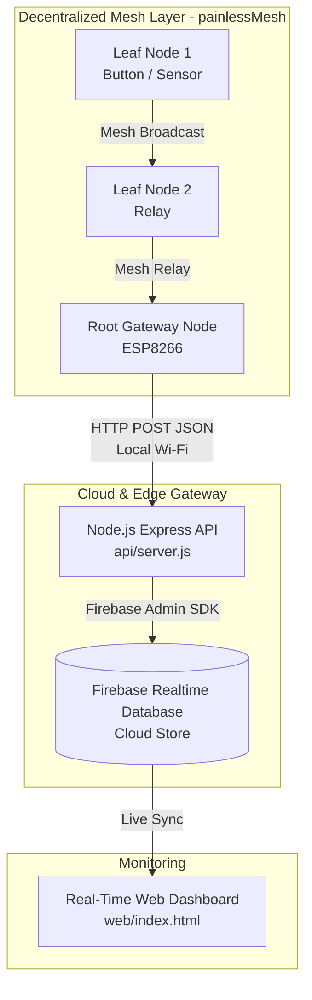

# 🚨 ESP8266 Mesh Disaster Alert System

[](https://www.espressif.com/)
[](https://gitlab.com/painlessMesh/painlessMesh)
[](https://nodejs.org/)
[](https://firebase.google.com/)
[](https://opensource.org/licenses/MIT)

A resilient, decentralized disaster alert mesh network designed to function without cellular coverage or central Wi-Fi routers. Uses **painlessMesh** on ESP8266 microcontrollers to relay emergency triggers peer-to-peer to an edge gateway, which publishes alert events to **Firebase Realtime Database** and a live monitoring web dashboard.

---

## 📌 Architecture



---

## ✨ Features

- **Decentralized Peer-to-Peer Mesh**:
  - Automatically self-organizing and self-healing ad-hoc network using `painlessMesh`.
  - Leaf nodes do not need Wi-Fi credentials or internet connectivity.
- **Hardware Button Debouncing**:
  - Non-blocking state transition filter on leaf nodes (`BUTTON_PIN 0` / D3) to prevent false multiple triggers during emergencies.
- **Root Node Cloud Bridge**:
  - Dual-mode operation: actively participates in the mesh network while connected to a local Wi-Fi station to bridge payloads outward.
- **Secure Cloud API Gateway**:
  - Express.js microservice validating payload node IDs, appending server-side timestamps, and storing events in Firebase.
- **Live Emergency Dashboard**:
  - Responsive dark-mode interface displaying real-time incoming alerts, node health, and event history.

---

## 📁 Repository Structure

```text
├── README.md                           # Documentation & system guide
├── .gitignore                          # Protected credential & dependency exclusions
├── leaf_node/
│   └── leaf_node.ino                   # Firmware for remote sensor/panic button nodes
├── root_node/
│   └── root_node.ino                   # Firmware for mesh-to-WiFi gateway node
├── api/
│   ├── package.json                    # API dependencies (Express, Firebase Admin)
│   ├── server.js                       # HTTP API gateway to Firebase
│   └── serviceAccountKey.example.json  # Template for Firebase credentials
└── web/
    └── index.html                      # Real-time incident dashboard
```

---

## 🚀 Setup & Deployment

### 1. Leaf Nodes (Sensor / Button)
1. Open `leaf_node/leaf_node.ino` in Arduino IDE.
2. Ensure `painlessMesh`, `ArduinoJson`, and `TaskScheduler` libraries are installed.
3. Flash to each remote ESP8266 (NodeMCU / Wemos D1 Mini).
4. Connect a momentary push button between **D3 (GPIO 0)** and **GND**.

### 2. Root Gateway Node
1. Open `root_node/root_node.ino`.
2. Configure your local Wi-Fi credentials and API host:
   ```cpp
   #define STATION_SSID     "YOUR_WIFI_SSID"
   #define STATION_PASSWORD "YOUR_WIFI_PWD"
   #define API_HOST         "192.168.1.100"  // IP of the computer running api/server.js
   #define API_PORT         3000
   ```
3. Flash to the gateway ESP8266 positioned within range of both the mesh and your Wi-Fi router.

### 3. API Gateway & Firebase
1. Navigate to the `api` folder and install dependencies:
   ```bash
   cd api
   npm install
   ```
2. In Firebase Console:
   - Go to **Project Settings** $\rightarrow$ **Service Accounts** $\rightarrow$ **Generate New Private Key**.
   - Save the downloaded file as `api/serviceAccountKey.json`.
3. In `api/server.js`, configure your database URL:
   ```javascript
   databaseURL: "https://YOUR-PROJECT-ID.firebaseio.com"
   ```
4. Start the gateway server:
   ```bash
   node server.js
   ```

### 4. Web Dashboard
- Open `web/index.html` in any modern web browser or serve it via your favorite web server.

---

## 🔒 Security Note
Private keys (`serviceAccountKey.json`) and local `.env` files are strictly excluded via `.gitignore` to prevent secret exposure. Always use `serviceAccountKey.example.json` as a reference when deploying.
